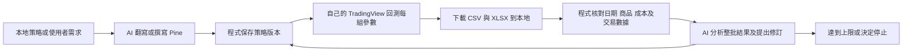

# Local Strategy Research Studio｜本地策略研究室

在自己的電腦上，把策略想法、參數回測與 AI 修訂接成有上限、可追溯的研究循環。

使用**自己的 TradingView 帳號**與**自己的 OpenAI API Key**。程式負責圖表操作、參數組合、下載與報告核對；AI 負責策略翻寫、新策略撰寫及已核對數據的分析。此專案與原 TradingView Assistant 分開維護。

**Technical beta，Windows x64。** 已包含自動化整合測試與桌面啟動驗收；各帳號的實際深度回測、Pine 編譯與付費 API 循環仍需自行驗收。TradingView 畫面更新可能影響操作。這是非官方研究工具。

## 下載與啟動

1. 前往 [Releases](https://github.com/charleswanghc/tradingview-strategy-research-studio/releases/latest)，下載 `local-strategy-research-studio-*-windows-x64.zip`。
2. **完整解壓縮**，雙擊 `LocalStrategyResearchStudio.exe`。免安裝版已包含執行環境，不必先裝 Node.js。
3. 依 [首次設定指南](docs/QUICKSTART.md) 選擇工作位置、設定 AI、載入 Chrome 橋接套件並配對。
4. 放入文字策略或填寫新策略需求，設定商品、日期、成本、候選參數與版本／測試上限，按「開始研究」。

Chrome 橋接套件位於解壓縮目錄的 `TradingViewBridge`。首次使用需在 `chrome://extensions` 開啟開發人員模式，選「載入未封裝項目」。此版本尚未上架 Chrome Web Store。免安裝程式尚未申請程式碼簽章。

## 每輪會做什麼



現有 Pine 可以停用 AI 分析，只執行參數回測。數值、布林與選項參數皆可列候選值。同一版策略會先跑完全部組合，再分析並提出下一版；測試總數與版本數由使用者限制。

輸出保存在使用者選定位置：`strategies` 放來源、`versions` 放每版 Pine、`runs` 放原始報告與測試記錄、`analysis` 放比較及 AI 分析。每個工作目錄會建立忽略規則，避免一般 Git 操作意外提交策略。

## 帳號與資料

- TradingView 登入由使用者在 Chrome 完成；本程式不索取密碼、Cookie 或帳號權杖。深度回測及歷史資料須由使用者帳號提供。
- 目前 AI 供應商支援 OpenAI。API 用量計入使用者自己的 API 帳戶；ChatGPT 訂閱與 API 用量分開。
- Windows 使用目前登入使用者的 DPAPI 加密 AI Key，保存在本機應用程式資料目錄。公開庫和下載包不附任何 Key、登入狀態、配對金鑰、私人策略或回測結果。
- 使用 AI 前需勾選同意。策略及整理後的回測摘要會傳給所選模型；策略也會提交到使用者自己的 TradingView 帳號編譯與回測。完整資料流與保存範圍見 [隱私說明](PRIVACY.md)。

## 支援範圍

Windows x64 桌面啟動器、Chrome Manifest V3 橋接、本機 HTTP/WebSocket 服務，以及選用的 MCP 模式。請將 TradingView 介面設為英文，以符合目前的控制項及報表核對。

目前回測基準為 USD、標準 K 線、UTC、固定口數、每合約每邊佣金、整數 tick 滑價、K 線收盤計算與下一 tick 撮合。無加碼、不使用 Bar Magnifier，未模擬保證金限制；連續期貨使用 B-ADJ 關閉、SET 開啟。分批出場及其他執行模型需另外適配。MultiCharts 請提供 UTF-8 `.txt`，Pine 請提供 `.pine`；ELD／PLA 請先匯出文字。

編譯失敗、報告過期、商品或設定不符、下載不能對應到本次回測、CSV／XLSX 不一致、圖表中斷時，循環會停止並保存已取得資料。實際可回測區間取決於商品及帳號；報告會標明實際涵蓋日期。

## 開發與原始碼啟動

安裝官方 Node.js 22.12 以上及 Chrome：

```powershell
git clone https://github.com/charleswanghc/tradingview-strategy-research-studio.git
cd tradingview-strategy-research-studio
npm run bootstrap
npm run build
npm test
npm start
```

原始碼建置的擴充套件位於 `extension/dist`。也可雙擊 `StartResearch.cmd`，第一次會安裝所需套件及建置。瀏覽器面板模式：`node scripts/start-research.cjs --browser`。桌面版自動挑選本機連接埠；瀏覽器模式預設使用 17365／17366，避免同時開啟衝突的服務。

獨立架構、MCP 與發行流程見 [開發說明](docs/DEVELOPMENT.md)，推廣文案見 [產品介紹](docs/PRODUCT_COPY.md)。問題與功能建議請使用 [Issues](https://github.com/charleswanghc/tradingview-strategy-research-studio/issues)，請刪除策略、Key、配對檔及私人報告後再提供資料。

## English

A local Windows desktop research app using your own TradingView login and OpenAI API key. Code runs bounded parameter batches, saves and verifies CSV/XLSX exports, and sends verified summaries to AI for analysis and strategy revisions. Download the portable ZIP from Releases, extract it completely, launch the EXE, and follow the first-run guide. This technical beta requires manual Chrome bridge installation and your own eligible TradingView account. No credentials or private research data are shipped.

GPL-3.0-only. Upstream credits and third-party notices are in [NOTICE](NOTICE).
